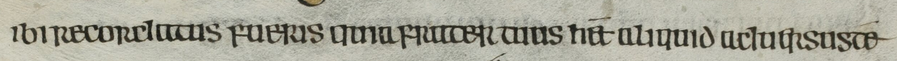

# Reading the Book of Kells by machine

**Summary.** No typed text of the Book of Kells' Gospel pages is publicly available. The only earlier computer study
of its letters sorted 180 hand-cut letters into 18 kinds and named about 81% of its test letters correctly (Purkayasth
2015). This project trains a handwriting reader to read whole lines of Kells and to place every letter on the page. The
reader is Kraken, trained first on St Gall 51, an Irish gospel book in the same script whose text is already typed,
then on 16 Kells pages typed for this project. On 8 Kells pages it never saw, it gets 2.85% of characters wrong.



| | |
|---|---|
| Reader | `ibi recordatus fueris quia frater tuus het aliquid aduersuste` |
| Typed text | `ibi recordatus fueris quia frater tuus het aliquid aduersus te` |

The St Gall reader on a typical line of a page it never trained on. Its one mistake is a missing word gap. Kells
images cannot be shown here (see Data and licence).

## How it works

**The reader.** Kraken reads one line image at a time and gives one character per step. Its starting model, CATMuS
Medieval 1.6.0, learned medieval manuscripts in four languages but no Insular script. It is fine-tuned on St Gall 51
(193 pages; 1.28% wrong on St Gall's own test pages), then on Kells. St Gall is cramped and full of shortened words,
while Kells is large, round and widely spaced. The St Gall reader alone gets 14.7% of Kells characters wrong.

**The answer key.** The key has 16 pages, 4 for each of Bernard Meehan's four scribes (A to D), drawn at random: 8 to
train on and 8 to test. 8 more pages were typed for training only. Each page was typed twice, separately. Claude had
Abbott's 1884 printed edition as a guide to the words, and GPT had the line images and the rules only. Where the two
differed, the line image decided. The typing rules follow St Gall 51's TEI transcription, so the reader is tested on
the signs it learned.

**Choosing how long to train.** The number of training passes is chosen on the training pages alone, in two halves
(train on one, measure on the other). The final model reads the test pages once.

## Results

| Reader | Characters wrong on the 8 test pages |
|---|---|
| St Gall reader alone | 14.7% |
| fine-tuned on 8 Kells pages | 3.70% |
| fine-tuned on 16 Kells pages | 2.85% |
| party, trained the same way | 3.16% |
| PP-OCRv6 medium, trained the same way | 3.41% |

By scribe: A 1.8%, B 4.9%, C 2.4%, D 3.0%. Each scribe has 2 test pages, so these are indicative. The key's own error
is not yet measured: no reader of Insular script has checked it. Against the settled key, GPT's first copy differs on
2.4% of characters and Claude's on 1.2%.

Two newer readers, party (Kiessling's transformer reader) and PP-OCRv6, went through the same St Gall and Kells
training on UCD's Sonic cluster and do worse, so Kraken's classic reader stays the chosen one.

Next: every Gospel page is read and each letter placed, for release as PAGE XML, TEI and CSV on Zenodo.

<details>
<summary>Reproducing (Python 3.11, Kraken 7.1.1, PyTorch; a GPU)</summary>

```bash
conda env create -f environment.yml && conda activate kells-letters
make test                                      # every gate's test
make download models manifests                 # page images, texts and base models (md5 tested)
make stgall-text stgall-seg stgall-xml split   # St Gall's lines, paired with its typed text
make reader RUN=catmus-1.6.0-extra EXTRA=1     # St Gall, then Kells, then the test pages read once
make tables                                    # the tables in notes/results.md, from results/
```

`notes/results.md` holds every number with the command that made it;
`results/<run>/` each run's record; `data/kells_key/` and `data/kells_extra/` the typed pages, both raw copies and
every decision with its reason. `sonic/` runs the same steps on Sonic.

</details>

## Credits

- [Kraken](https://kraken.re) and party, by Benjamin Kiessling.
- The CATMuS Medieval model ([1.6.0](https://doi.org/10.5281/zenodo.21488839)).
- Stiftsbibliothek St. Gallen, Cod. Sang. 51, through [e-codices](https://www.e-codices.unifr.ch/en/list/one/csg/0051)
  (CC BY-NC 4.0), and its TEI transcription from the Verbum Project's Insular Gospels (University of Birmingham).
- Meehan's division of the Kells text among four scribes, as reproduced in MacGabhann (2015).
- Purkayasth (2015), Trinity College Dublin thesis, the earlier computer study of the Kells letters.
- Trinity College Dublin Library, for the Book of Kells images (MS 58).

## Data and licence

The Kells images are used under Trinity's terms (single-use academic application), so no Kells image, line image or
letter crop is in this repository or its releases; every record names its Trinity folio. Licences:
code MIT (`LICENSE`), the typed key CC BY, and machine readings and model weights CC BY-NC, because the model learns from the
non-commercial St Gall images and text.
